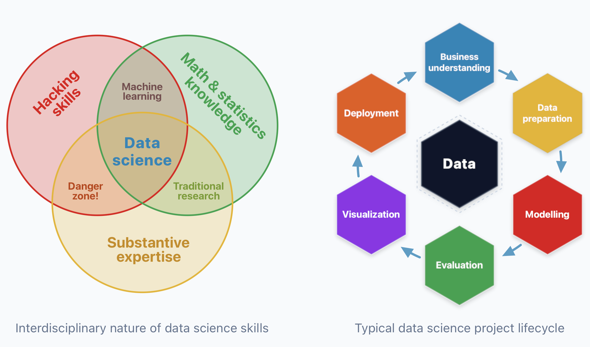
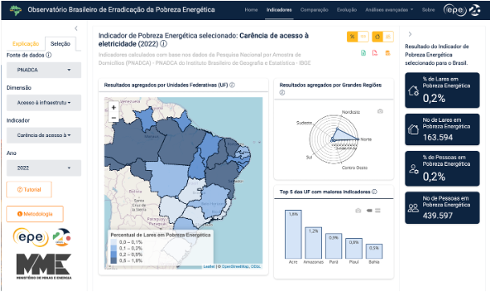
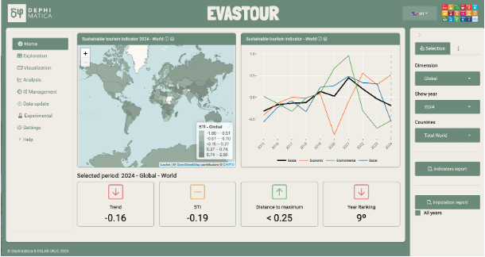
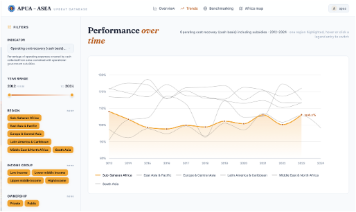
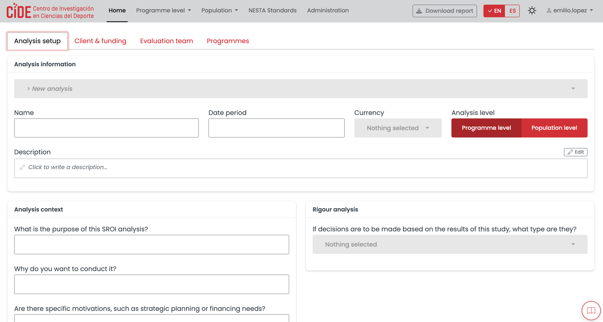

## Contenidos

:::{.huge}
1. Introducción

2. Sistemas de Indicadores

3. Casos de éxito
:::

# 1. Introducción

## Ciencia de Datos

{style= "width='80%'"}

## DSLAB

::: {.columns}

::: {.column}

:::

::: {.column}

:::

:::

:::{.huge style = "text-align: center"}
<https://www.datasciencelab.es>
:::

# 2. Sistemas de Indicadores

## Variables vs. indicadores

* **Variable**: característica de un fenómeno que puede medirse y tomar diferentes valores.

* **Indicador**: medida que permite evaluar un fenómeno, proceso o situación, a partir de una o varias variables.

💡 Idealmente: almacenar los valores de las variables para ser utilizadas en diferentes indicadores. Si no es posible, guardar el indicador, conociendo las limitaciones.

## Cálculo de indicadores

* **Indicadores igual a variable**: La propia variable se considera indicador (no hay un cálculo).

* **Indicadores calculados**: se calculan a partir de varias variables, que pueden ser de diferente naturaleza y escala.

💡 A veces a las variables se les llama "microdatos", especialmente si provienen de encuestas.

🧮 Pueden ser operaciones matemáticas simples, o transformaciones más complejas.

## El reto espacio-temporal

* Indicadores y variables normalmente se referirán a un **espacio** y un **tiempo** determinados. 

* Las variables no siempre van a ser **comparables** en el espacio. Ejemplo: número de empleados en el sector del deporte. 

* Por eso es importante calcular **indicadores**. Ejemplo: número de empleados en el sector del deporte por cada 1000 habitantes.

* El agregado espacio-temporal presenta el reto de la operación de resumen (suma, media, otro, ...)

## El reto de la disponibilidad

### Valores perdidos

Si una variable no está disponible para un espacio y tiempo determinado, el indicador no se puede calcular.

### Disponibilidad a tiempo

Publicación: a menudo los datos se publican después de mucho tiempo. Para datos multi-geográficos, puede estar disponible en un país y no en otro.

## Indicadores compuestos

* **Indicadores compuestos**: se calculan a partir de varios indicadores, que pueden ser de diferente naturaleza y escala.

* Como paso previo, los indicadores se **normalizan** para que sean comparables. Hay varios métodos: min-max, z-score, percentil, etc.

* Los indicadores normalizados se **agregan** para obtener el indicador compuesto. Hay varios métodos: media, mediana, suma ponderada, etc.

[Handbook on Constructing Composite Indicators: Methodology and User Guide](https://www.oecd.org/en/publications/handbook-on-constructing-composite-indicators-methodology-and-user-guide_9789264043466-en.html)

## Estándares y metadatos

* **Metadatos**: información que describe los datos, incluyendo su origen, fecha de actualización, metodología de cálculo, unidades, etc.

* **Estándares**: normas que aseguran la consistencia y comparabilidad de los indicadores a nivel internacional. 

[SDMx - The standard for Statistical Data and Metadata](https://sdmx.org)

## Despliegue de plataformas

* **Base de datos de indicadores**: almacenamiento de los valores de las variables y/o indicadores, junto con sus metadatos.

* **Visualización interactiva**: gráficos, mapas, tablas, etc. que permiten explorar los indicadores de manera intuitiva.

* **Datos abiertos**: principios FAIR. Descargas o APIs para acceder a los datos de manera programática.

* **Gestión de indicadores**: herramientas para crear, actualizar y eliminar indicadores, así como para gestionar sus metadatos.

* **Seguridad y privacidad**: control de acceso a los datos y cumplimiento de la normativa de protección de datos.

* **Modelos de IA y predicción**: integración de modelos de inteligencia artificial para generar predicciones o simulaciones basadas en los indicadores.

# 3. Casos de éxito

Mucho más que tableros

## Observatorio de pobreza energética 

[Observatório Brasileiro de Erradicação da Pobreza Energética](https://dashboard.epe.gov.br/apps/OBEPE/)

## Plataforma de turismo sostenible 

Plataforma de Exploración, Visualización y Análisis del turismo sostenible (EVASTOUR)

## Modernización bases de datos de APUA 

Proyecto del banco africano de desarrollo

## SROI

Social Return on Investment (SROI). Plataforma de gestión de programas.

## PACE

